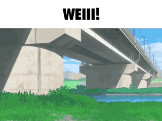

## Hi there 👋

  

I'm a student game developer who loves making games, especially shooters. Also a big fan of Japan 🇯🇵

### 🛠 Tech stack

### 🎮 What I do

- 🥽 VR and AR games in Unity
- 📖 Visual novels with AI features
- 🔫 Experimenting with shooter mechanics

<picture>
  <source media="(prefers-color-scheme: dark)" srcset="https://raw.githubusercontent.com/VIzumrudik/VIzumrudik/output/github-snake-dark.svg">
  <source media="(prefers-color-scheme: light)" srcset="https://raw.githubusercontent.com/VIzumrudik/VIzumrudik/output/github-snake.svg">
  
</picture>

### 📫 Contact

